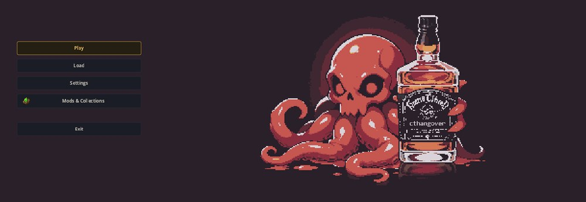
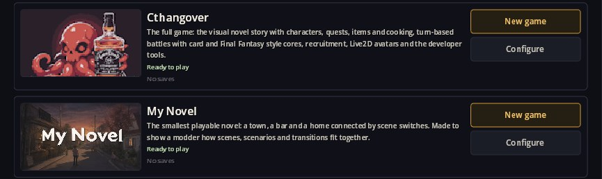
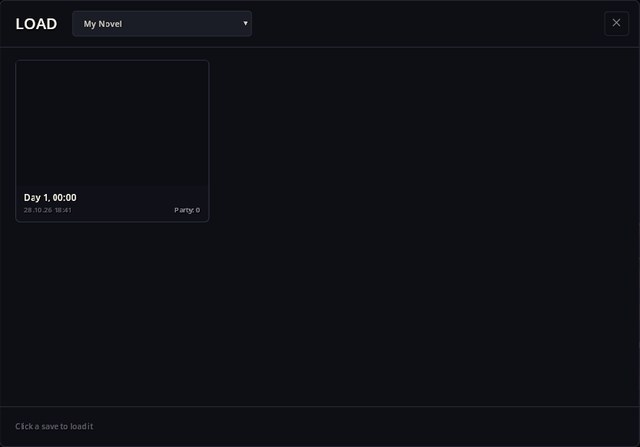
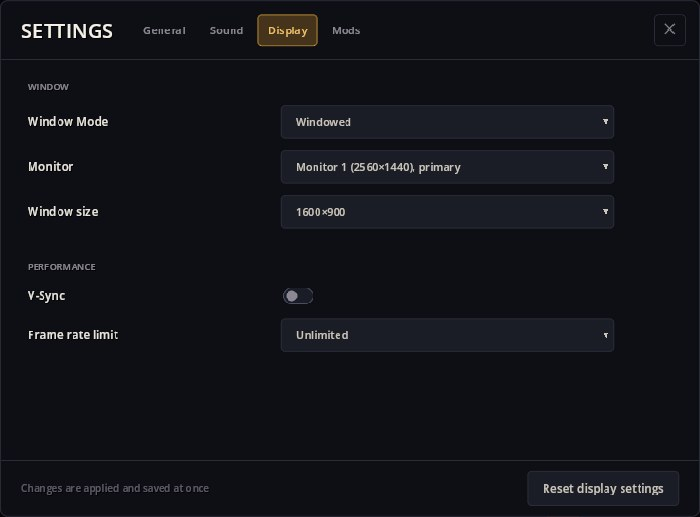
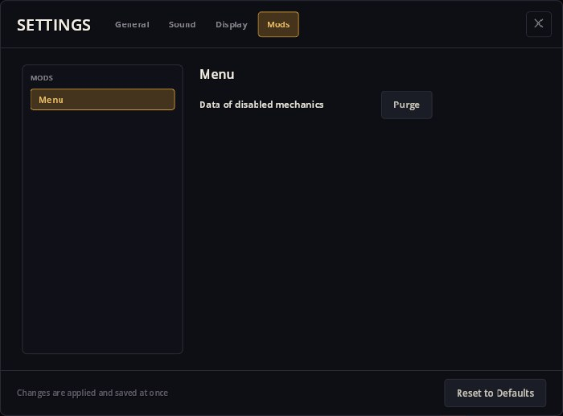

# Menu — メインメニュー、ゲーム選択、セーブ、設定

Menu は起動して最初に目にする画面です。**プレイ**、**ロード**、**設定**、**MOD とコレクション**、**終了**の並ぶタイトルメニューです。ここからインストール済みのゲームを一つ選び、始めたり続きから再開したり、セーブをロードしたり、言語・サウンド・表示の設定を変えたりできます。他の MOD が独自のボタンや設定ページを追加することもできます。

Menu は常に読み込まれるシェルの一部なので、どのゲームを始める前からそこにあります。



## ゲームを始める

**プレイ**を押すと**ゲームを選択**が開きます。コレクションにあるゲームはそれぞれ、カバー・説明・準備状況・セーブ数を添えたカードとして並びます。



- **ニューゲーム**はゲームの最初のシーンから始めます。メニューは同じウィンドウのままそのゲームの MOD セットに切り替わります。再起動は不要です。
- カードの**続きから**はそのゲームの最新セーブを再開します。**セーブ**で一覧を出せます。
- **足りないものをインストール**は、ゲームに必要な MOD が足りないときに現れ、ダウンロードします。
- **設定する**は MOD マネージャーでゲームの構成を開きます。

メニューを見ている間に、各ゲームの MOD がバックグラウンドで準備されます。下のヒントが、起動が速くなるタイミングを教えてくれます。

メインメニュー自身の**続きから**は、一度でもプレイすると現れます。最後に使ったゲームとセーブへ戻ります。

## セーブをロードする

**ロード**は一度に一つのゲームのセーブを表示します。上のセレクターでゲームを選び、セーブをクリックするとロードします。



セーブの後でゲームの MOD が変わっていた場合は、**ゲームが変わりました**ウィンドウが、追加されたもの(最初から)、削除されたもの(データは残り、有効にすれば戻る)、更新されたものを一覧し、ロードの前にセーブのバックアップを作ります。ゲームという仕組みができる前のセーブは**ゲームのないセーブ**に表示されます。属するゲームを選ぶと、ファイルがそちらへ移ります。

ゲーム中のセーブとロードは、ゲーム内メニューから同じウィンドウを使います。スロットをクリックしてセーブ、使用中のスロットは確認後に上書き、**+ 新しいセーブ**で追加します。

## 設定

**設定**には四つのタブがあります。変更はすぐに反映・保存されます。

- **一般** — インターフェースの言語。
- **サウンド** — 効果音・音楽・アンビエンスのオン/オフと音量。
- **表示** — ウィンドウモード(ウィンドウ、最大化、ボーダーレス、排他フルスクリーン)、モニター、ウィンドウサイズ、V-Sync、フレームレート制限、そして**表示設定をリセット**。
- **MOD** — インストール済み MOD が追加する設定ページと**既定に戻す**。





**MOD** タブにある Menu 自身のページが**無効にしたメカニクスのデータ → 削除**です。ゲームに属さなくなった MOD のデータをすべてのセーブから取り除きます。確信が持てるときだけ使いましょう。もう一度有効にしたメカニクスは最初からになります。

## Menu が頼っているもの

Menu は画面を描き、各ボタンの挙動を決めます。ゲームの一覧と準備状況はコレクションから、ゲームの起動・切り替え・保存はエンジンのゲームセッションとセーブサービスが担います。タイトル画面の音楽は Menu が要求する Music Pack の `MainMenu` プレイリストです。**MOD とコレクション**は Mod Manager が提供します。

## MOD 作者向け:ボタンや設定ページを追加する

ボタンは固定画面ではなくレジストリーから来るので、MOD は追加・置き換え・並べ替えができます。Mod Manager は manifest の `main_menu` エントリーで自分のボタンを足しています:

```json
"main_menu": [
  {
    "id": "mods_hub",
    "scene_path": "scenes/mods_hub_screen.tscn",
    "button": { "icon": "mod_manager", "locale": "mod_manager/menu_title", "index": 100 }
  }
]
```

MOD の設定は、MOD が MOD 設定レジストリーに設定定義を登録すると **MOD** タブに現れます。Menu が削除アクションでそうしているのと同じです。ボタンや設定の文言は MOD 自身のローカライゼーションから来ます。

## うまく動かないとき

1. **プレイの下にゲームがない。** 種類が *ゲーム* のコレクションが一つもインストール・有効化されていません。**MOD とコレクション**を開いてください。
2. **カードに「足りない MOD」や「互換性のないバージョン」と出る。** **足りないものをインストール**を使うか、**設定する**で問題を確認してください。
3. **「続きから」がない。** 一度でもプレイすると現れます。
4. **ウィンドウのサイズが保たれない。** **表示 → ウィンドウモード**を確認してください。ウィンドウサイズはウィンドウモードでだけ効きます。
